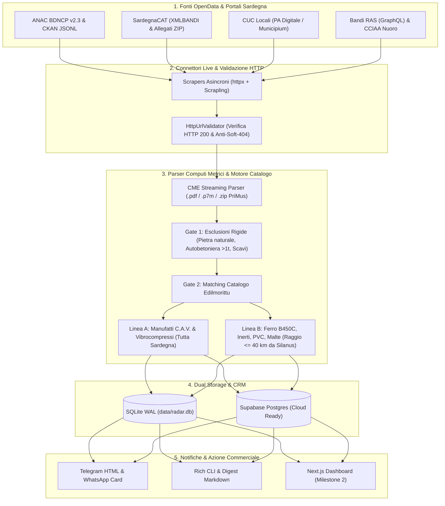

# Architettura del Sistema — Sardegna B2B Radar

**Sardegna B2B Radar** è un motore asincrono di intelligence commerciale B2B progettato per **EDILMORITTU S.R.L.** (Silanus, NU). Intercetta gare d'appalto pubbliche aggiudicate, gare aperte e bandi regionali/camerali in Sardegna, analizza i Computi Metrici Estimativi (CME) e qualifica le opportunità di fornitura edile prima dell'apertura del cantiere.

---

## 1. Flusso Dati a Imbuto (Pipeline End-to-End)

---

## 2. Mappa dei Moduli (`src/sardegna_radar/`)

| Modulo / File | Responsabilità Principale |
| :--- | :--- |
| [`config.py`](src/sardegna_radar/config.py) | Gestione configurazione e variabili d'ambiente tramite `pydantic-settings`. |
| [`models.py`](src/sardegna_radar/models.py) | Modelli dati immutabili Pydantic (`TenderNotice`, `ScoredLead`, `CMEItem`, `CRMStatus`, `LogisticsTier`). |
| [`exceptions.py`](src/sardegna_radar/exceptions.py) | Gerarchia di eccezioni tipizzate (`RadarError`, `ScraperError`, `CMEParseError`, `StorageError`). |
| [`scrapers/anac_api.py`](src/sardegna_radar/scrapers/anac_api.py) | Client ANAC BDNCP (`appalto v2.3`) e dataset CKAN 2026: estrae vincitore, P.IVA, RUP, ribasso e stato cantiere. |
| [`scrapers/sardegna_cat.py`](src/sardegna_radar/scrapers/sardegna_cat.py) | Parser SardegnaCAT (`XMLBANDI`) e risoluzione link allegati progettuali (`DownloadAttach.asp`). |
| [`scrapers/sardegna_portals.py`](src/sardegna_radar/scrapers/sardegna_portals.py) | Connettori adattivi per CUC locali (es. Comunità Montana Nuorese) e portali Municipium/PA Digitale. |
| [`scrapers/grants_ras_cciaa.py`](src/sardegna_radar/scrapers/grants_ras_cciaa.py) | Connettore GraphQL per Bandi Regione Sardegna e scraper HTML per contributi CCIAA Nuoro. |
| [`scrapers/url_validator.py`](src/sardegna_radar/scrapers/url_validator.py) | Validatore asincrono che segue i redirect, controlla `HTTP 200` e scarta pagine soft-404. |
| [`cme/parser.py`](src/sardegna_radar/cme/parser.py) | Estrattore streaming di Computi Metrici da PDF/ZIP PriMus con classificazione Linea A / Linea B ed esclusioni. |
| [`matcher/cav_engine.py`](src/sardegna_radar/matcher/cav_engine.py) | Motore deterministico di scoring C.A.V., calcolo distanza da Silanus (`Tier 1 <=40km`, `Tier 2 40-100km`, `Tier 3 >100km`) e filtri CPV. |
| [`storage/repository.py`](src/sardegna_radar/storage/repository.py) | Persistenza locale su SQLite in modalità `WAL` con deduplicazione idempotente su `(source, external_id)`. |
| [`storage/supabase_repo.py`](src/sardegna_radar/storage/supabase_repo.py) | Adapter REST/Postgres per sincronizzare gare, voci CME e stati CRM su Supabase. |
| [`notifiers/telegram.py`](src/sardegna_radar/notifiers/telegram.py) | Formattatore zero-fluff per messaggi Telegram HTML, card WhatsApp e digest Markdown. |
| [`cli.py`](src/sardegna_radar/cli.py) | Interfaccia a riga di comando (`scan`, `parse-cme`, `leads`, `set-status`, `stats`, `export`). |

---

## 3. Logica di Scoring & Logistica da Silanus (SS 129 km 82,200)

1. **Finestra Temporale Perfetta (Golden Window):**
   - Il punteggio massimo viene assegnato agli appalti **aggiudicati** in cui `avvioContratto` è vuoto e non risultano subappalti registrati: l'impresa vincitrice sta preparando gli acquisti dei materiali.
2. **Tier Logistici:**
   - **Tier 1 (`<= 40 km` da Silanus):** Vantaggio competitivo totale sia per **Linea A** (C.A.V.) sia per **Linea B** (ferro, inerti, PVC, malte). Include Silanus, Bolotana, Lei, Bortigali, Macomer, Dualchi, Noragugume, Ottana, Sedilo, Ghilarza, Bono, Nuoro, Orotelli, Orani.
   - **Tier 2 (`40 – 100 km` da Silanus):** Ottimo per carichi completi **Linea A** con camion autogru (Oristano, Sassari, Olbia, Ozieri, Alghero, Bosa, Tortolì).
   - **Tier 3 (`> 100 km` da Silanus):** Conveniente per forniture **Linea A** ad alto valore aggiunto (pozzetti stradali, loculi cimiteriali, grandi lotti C.A.V. nel Sud Sardegna / Cagliari / Sulcis).
