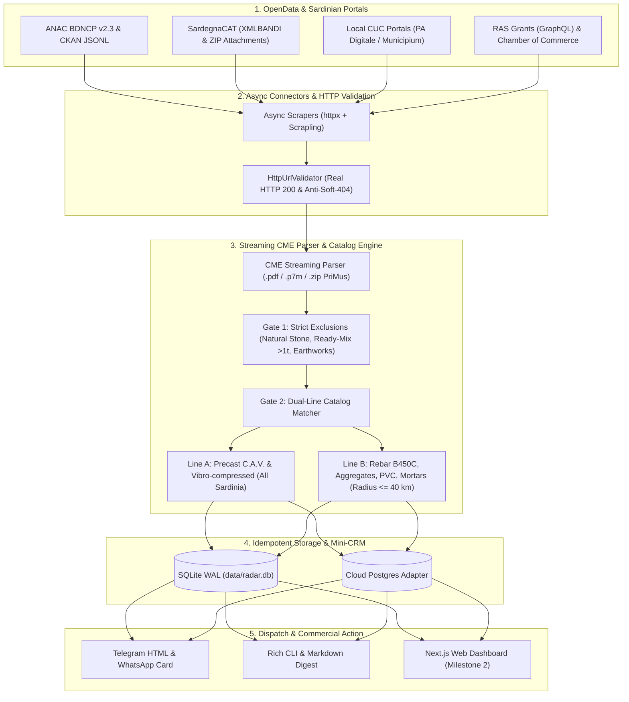

# System Architecture — Sardegna B2B Procurement Radar

**Sardegna B2B Radar** is an asynchronous B2B procurement intelligence engine designed for Sardinian precast concrete (*C.A.V. / Vibrocompresso*) manufacturers and construction material suppliers. It intercepts awarded public works tenders, open tenders, and regional SME grants across Sardinia, parses Bills of Quantities (*Computi Metrici Estimativi* — CME), and qualifies supply opportunities before construction sites open.

---

## 1. End-to-End Data Funnel

---

## 2. Module Map (`src/sardegna_radar/`)

| Module / File | Primary Responsibility |
| :--- | :--- |
| [`config.py`](src/sardegna_radar/config.py) | Environment and logistics hub configuration via `pydantic-settings`. |
| [`models.py`](src/sardegna_radar/models.py) | Immutable Pydantic v2 domain models (`TenderNotice`, `ScoredLead`, `CMEItem`, `CRMStatus`, `LogisticsTier`). |
| [`exceptions.py`](src/sardegna_radar/exceptions.py) | Typed exception hierarchy (`RadarError`, `RadarNetworkError`, `UrlValidationError`, `CMEParseError`, `StorageError`). |
| [`scrapers/anac_api.py`](src/sardegna_radar/scrapers/anac_api.py) | ANAC BDNCP (`appalto v2.3`) and CKAN 2026 client: extracts winner, Tax ID, RUP, rebate %, and contract start status. |
| [`scrapers/sardegna_cat.py`](src/sardegna_radar/scrapers/sardegna_cat.py) | SardegnaCAT (`XMLBANDI`) parser and attachment link resolver (`DownloadAttach.asp`). |
| [`scrapers/sardegna_portals.py`](src/sardegna_radar/scrapers/sardegna_portals.py) | Adaptive HTML parsers for local CUC portals (Municipium / PA Digitale). |
| [`scrapers/grants_ras_cciaa.py`](src/sardegna_radar/scrapers/grants_ras_cciaa.py) | Apollo GraphQL client for Autonomous Region of Sardinia (RAS) grants and Chamber of Commerce notices. |
| [`scrapers/url_validator.py`](src/sardegna_radar/scrapers/url_validator.py) | Async validator verifying `HTTP 200` status and rejecting soft-404 pages. |
| [`cme/parser.py`](src/sardegna_radar/cme/parser.py) | Streaming Bill of Quantities extractor for PriMus PDFs/ZIPs with Gate 1 exclusions and Line A/B classification. |
| [`matcher/cav_engine.py`](src/sardegna_radar/matcher/cav_engine.py) | Deterministic C.A.V. scoring engine, road distance tiering (`Tier 1 <=40km`, `Tier 2 40-100km`, `Tier 3 >100km`), and CPV boosters. |
| [`storage/repository.py`](src/sardegna_radar/storage/repository.py) | Local SQLite `WAL` persistence with idempotent upsert on `(source, external_id)`. |
| [`notifiers/telegram.py`](src/sardegna_radar/notifiers/telegram.py) | Zero-fluff formatter for Telegram HTML notifications, WhatsApp cards, and Markdown digests. |
| [`cli.py`](src/sardegna_radar/cli.py) | Typer/Rich CLI (`scan`, `parse-cme`, `leads`, `set-status`, `stats`, `export`). |

---

## 3. Scoring Logic & Logistics Tiers (Central Sardinia Hub)

1. **Pre-Construction Golden Window:**
   - Maximum priority is assigned to **awarded** public works tenders where `avvioContratto` is empty and no subcontracts are registered yet—capturing the exact moment when the winning contractor is sourcing materials.
2. **Road-Freight Logistics Tiers:**
   - **Tier 1 (`<= 40 km` from Central Hub):** Full competitive advantage for both **Line A** (Precast C.A.V.) and **Line B** (rebar, aggregates, PVC, technical mortars).
   - **Tier 2 (`40 – 100 km`):** Optimal for full crane-truck loads of **Line A** precast concrete products.
   - **Tier 3 (`> 100 km`):** High-margin **Line A** precast structures (road manholes, prefabricated cemetery niches, large drainage lots).
