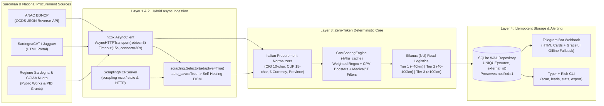

# Sardegna B2B Tender & Procurement Radar (`sardegna-b2b-radar`)

[](https://www.python.org/)
[](https://github.com/D4Vinci/Scrapling)
[](https://www.python-httpx.org/)
[](#architecture)

**Sardegna B2B Tender & Procurement Radar** is an asynchronous, fault-tolerant public procurement and regional grant intelligence engine built for Sardinian precast concrete (**C.A.V. — Calcestruzzo Armato Vibrocompresso**) manufacturers and civil infrastructure SMEs.

It monitors public infrastructure tenders, contract awards (*aggiudicazioni*), and non-repayable SME grants across Sardinia (**SardegnaCAT**, **ANAC BDNCP OCDS**, **Regione Autonoma della Sardegna — RAS**, and **CCIAA Nuoro**), automatically matching civil works that require **CE / DoP certified vibro-compressed concrete products (C.A.V.)** and calculating road-freight tiers from Central Sardinia (*Silanus / Macomer Industrial Hub, NU*) at **$0.00 daily LLM token cost**.

---

## 1. System Architecture



### Key Engineering Decisions
1. **Reverse-API First + Adaptive Scrapling Fallback:** Structured JSON/OCDS endpoints (`ANACReverseAPIConnector`) are queried directly over `httpx.AsyncClient` with `AsyncHTTPTransport(retries=3)`. Portal HTML pages (`SardegnaPortalAdaptiveScraper`) use `scrapling.Selector(..., adaptive=True)` with `auto_save=True` so element fingerprints self-heal when regional portals alter CSS classes or wrapper tags.
2. **Zero Paid LLM API Calls in the Daily Loop:** Scraping 100+ notices daily through an LLM is expensive, slow, and prone to hallucinating CIG codes. `CAVScoringEngine` uses `@functools.lru_cache` pre-compiled regex rules, CPV prefix boosters (`45231300-8`, `45215400-1`, `45233140-2`, `44114200-4`), and negative exclusions (penalizing hospital *"tubi endotracheali"*, school catering, and office stationery so false positives score `< 20/100`).
3. **Silanus (NU) Logistics Tiering & Sub-Supply Targeting:** Every notice is mapped to road-freight distance tiers from Silanus (SS 129 / SS 131 junction). When an ANAC contract award includes a winning contractor (`winner_company`), the engine generates a direct B2B outreach action for the contractor's purchasing office.
4. **Idempotent SQLite WAL Persistence:** `RadarRepository` enables `PRAGMA journal_mode=WAL;` and deduplicates on `dedup_key` (`source:cig`) and `UNIQUE(source, external_id)`. Re-scanning the same feed inserts `0` duplicate rows and never re-triggers already dispatched Telegram notifications.

---

## 2. Precast C.A.V. Product Lines & Scoring Matrix

| Category (`CAVProductCategory`) | Target Infrastructure / Grant Signals | Primary CPV Boosters |
| :--- | :--- | :--- |
| **Tubi C.A.V. & Condotte** | Tubazioni in calcestruzzo armato vibrocompresso, collettori fognari, condotte idriche, acque bianche/meteoriche, DN 300–1200, CE/DoP | `45231300-8`, `45232410-9`, `44163100-1` |
| **Pozzetti & Camere d'Ispezione** | Pozzetti prefabbricati, caditoie stradali, camere d'ispezione, chiusini, prolunghe | `44114200-4` |
| **Cordoli Stradali & Cunette** | Cordoli in calcestruzzo, cunette alla francese, zanelle, marciapiedi, sottoservizi, SS 131 / ANAS | `45233140-2`, `45233222-1` |
| **Blocchi Vibrocompressi** | Blocchi in calcestruzzo vibrocompresso, murature portanti e di contenimento, manufatti in cemento | `44114200-4` |
| **Edilizia Cimiteriale** | Loculi prefabbricati in C.A.V., ampliamento cimitero comunale, colombari, ossari | `45215400-1` |
| **Bandi Regionali PMI** | Voucher Digitali I4.0 PID (CCIAA Nuoro 68%), bandi RAS / SIPES a fondo perduto, fotovoltaico industriale | N/A (NoticeType Boost) |

---

## 3. Quickstart & CLI Usage

### Installation

```bash
uv venv --python 3.12 .venv
uv pip install -e ".[dev]"
```

### Run the End-to-End Pipeline

```bash
# 1. Initialize the SQLite WAL database
sardegna-radar init-db

# 2. Run a full scan on the realistic Sardinian procurement & grant dataset
sardegna-radar scan --demo

# 3. Inspect qualified B2B leads (score >= 45) in a Rich terminal table
sardegna-radar leads --min-score 45

# 4. Filter specifically for Nuoro province (Tier 1 Core <40km from Silanus)
sardegna-radar leads --min-score 45 --province NU

# 5. View portfolio statistics and cumulative tender value in EUR
sardegna-radar stats

# 6. Export a portable Markdown commercial digest
sardegna-radar export --output data/sardegna_b2b_digest.md

# 7. Inspect or start the Scrapling MCP Server for interactive AI agent DOM inspection
sardegna-radar mcp-server --dry-run
```

---

## 4. Running the Deterministic Test Suite

All network connectors (`ANACReverseAPIConnector`, `SardegnaPortalAdaptiveScraper`, and `TelegramNotifier`) are tested offline using `pytest-httpx` (`httpx_mock: HTTPXMock`) and `pytest-asyncio`:

```bash
pytest -v
```
